<p align="center">
  
</p>


### `▍01` // O QUE É ESTA ORGANIZAÇÃO

> **Organização oficial dos devs da Afterlife RP.**
> Aqui os devs criam e enviam os scripts que desenvolveram. Antes de qualquer coisa chegar perto do servidor, cada entrega passa por **revisão de segurança** e **teste em ambiente isolado**.
> Tudo fica registrado em Pull Request, com histórico, comentários e resultado da revisão. **Transparência total.**


### `▍02` // PROTOCOLO

<p align="center">
  
</p>

```txt
01  ENTREGA      o dev cria um repositório PRIVADO na org e abre um Pull Request com o script
02  SEGURANÇA    a equipe revisa o código: backdoors, chamadas externas, SQL, permissões
03  TESTE        o script roda numa máquina isolada, sem dados reais e sem acesso à produção
04  RETORNO      aprovação ou pedido de ajuste vem como comentário no próprio Pull Request
```


### `▍03` // COMO ENVIAR UM SCRIPT

1. **Novo repositório** → dono `afterlife-roleplay-2077` → visibilidade **Private** → nome `script-<nome-do-recurso>`.
2. Suba o código numa branch (`entrega/v1`) e abra um **Pull Request** para a `main`.
3. Preencha o template do PR: o que o script faz, dependências, tabelas SQL e como testar.
4. Aguarde a revisão. **Não** mande código por Discord, Drive ou link externo.


### `▍04` // REGRAS DE ACESSO

```diff
+ [OK]   Código legível, com dependências e versões declaradas
+ [OK]   Configs com valores de exemplo (config.example)
+ [OK]   SQL de criação das tabelas junto com a entrega
+ [OK]   Entregas grandes divididas em capítulos: um PR por capítulo
+ [OK]   2FA ativo na conta do GitHub (obrigatório para entrar na org)

- [NEGADO]  Repositórios públicos: toda entrega é PRIVADA
- [NEGADO]  Tokens, senhas, webhooks ou connection strings no código
- [NEGADO]  Arquivos ofuscados ou criptografados sem combinar antes
- [NEGADO]  Binários e scripts (.exe .dll .bat .ps1) sem justificativa
- [NEGADO]  Chamadas externas escondidas (HTTP, downloads, webhooks)
```


### `▍05` // TERMINAL

```console
afterlife@qa:~$ status --org
  ▸ devs parceiros ......... conectados via Pull Request
  ▸ 2FA .................... obrigatório
  ▸ ambiente de teste ...... isolado
  ▸ revisão de segurança ... obrigatória
  ▸ deploy no servidor ..... só após aprovação

afterlife@qa:~$ █
```

<p align="center">
  
</p>
